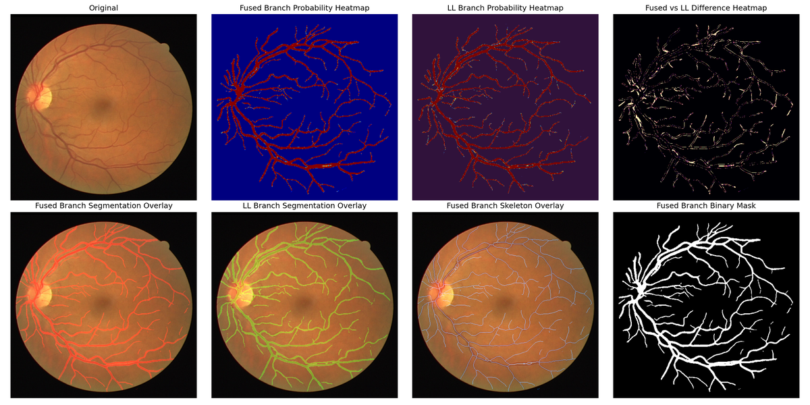

# FRetinalNet — Frequency-Domain Dynamic Convolution for Retinal Vessel Segmentation

Official release of our retinal vessel segmentation model on the [DRIVE](https://drive.grand-challenge.org/) dataset.
The model is a dual-branch encoder–decoder network: a ResNet-50 encoder with a **FFTBlock** (Frequency Feature Tuning Block — convolutional kernels parameterized as complex spectral bases with input-adaptive modulation and spectrum refinement) appended to each stage, a fixed Haar dual-tree complex wavelet (DTCWT) input decomposition feeding a second frequency-composite branch, **FaFBlock** (Frequency Aware Fusion Block) for unidirectional frequency-to-spatial cross-branch fusion, and ASPP + dual-resolution decoders with composite (channel/spatial/edge) attention and PixelShuffle upsampling — the architecture described in the paper *"A Frequency-Driven Method for Retinal Vessel Segmentation"*.
IF there are any questions, please contact 202224131096@stu.cqu.edu.cn


## Quickstart
```bash
# 1) install
pip install -r requirements.txt

# 2) download the pretrained weights (~2.9 GB) from Hugging Face
python scripts/download_weights.py        # -> weights/dice_fdconv_drive_ori.pth

# 3) get DRIVE (registration required) and check the layout
#    https://drive.grand-challenge.org/
python scripts/prepare_drive.py --root data/DRIVE

# 4) evaluate
python eval_test.py --test-root data/DRIVE


## Dataset license

The DRIVE dataset (Niemeijer, Staal et al., 2004/2008) is **not** redistributed here. It must be downloaded by each user after registration at [drive.grand-challenge.org](https://drive.grand-challenge.org/).

## License & acknowledgements

Code released under the [MIT License](LICENSE). The ResNet definition in `fretinalnet_notebook/resnet.py` is adapted from [torchvision](https://github.com/pytorch/vision) (BSD 3-Clause).


